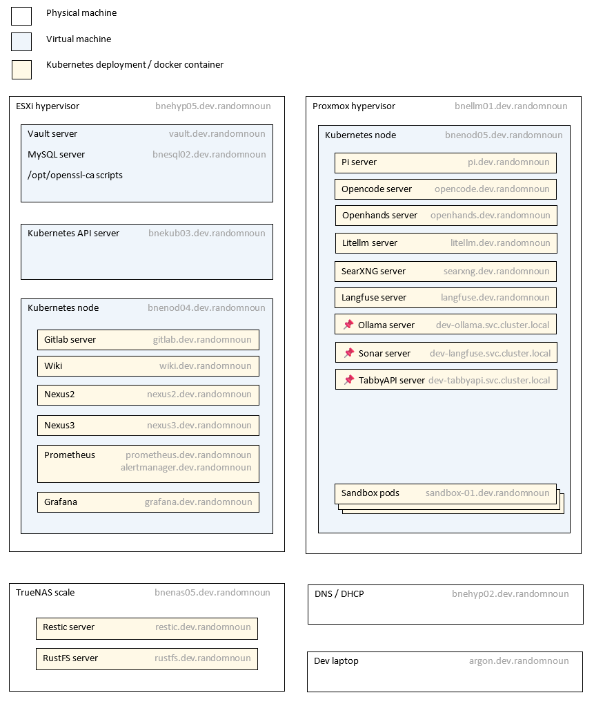

# bookcase-ops architecture

OK so here's the plan, stan.

Note that I've dumped most of the LLM-related pods on `bnenod05` on this diagram but now there's more than one node, most pods may get scheduled on either `bnenod04` or `bnenod05` .
  
Only the pods with a pin icon ( 📌 ) are pinned to that node, as it's the node with the GPUs in it.  
  

