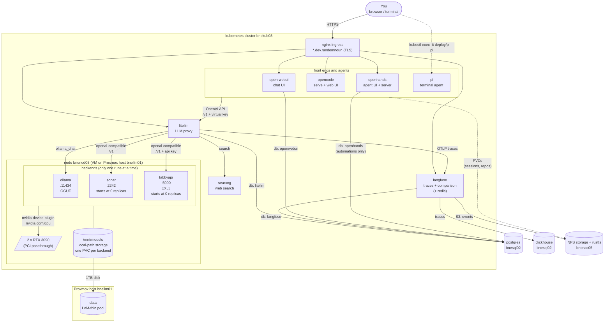

# bookcase-ops LLM architecture

Part of the [LLM setup](SETUP-LLM.md).

A maze of twisty little components, all alike:

So the plan is that whilst I'm still working out how this is supposed to work, I'll have a few different frontends / UIs, and a few different backends.

Everything will get funnelled through litellm, which will act as a proxy for the frontends to talk to the backends.  
This should keep most of the LLM config is centralised somewhere, and should make it easier to connect to remote LLMs later. 
Each frontend has a different litellm virtual API key, so I can see what's going where.

The backends are pinned to `bnenod05` ( they need the GPUs to operate). 
Each backend requests both GPUs, so only one can run at a time: `ollama` runs by default and `sonar` and `tabbyapi` start scaled to 0, see [Switching between engines](SETUP-LLM-BACKEND.md#switching-between-engines).
