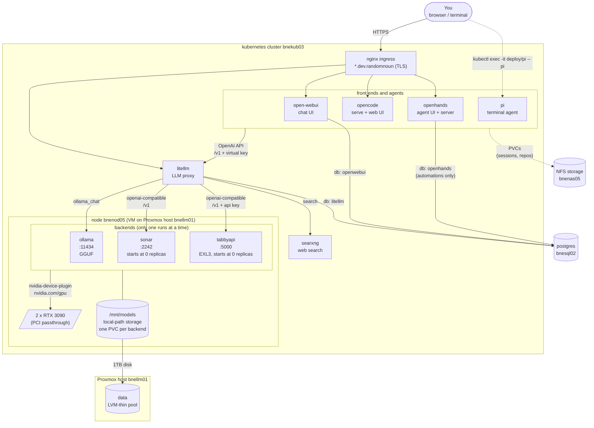

# bookcase-ops LLM setup

## Overview

A maze of twisty little components, all alike:



Nothing but `litellm` talks to the backends ( `ollama`, `sonar`, `tabbyapi` ); everything else goes through litellm's API, using its own virtual key.
 
Only the backends are pinned to `bnenod05` ( they need the GPUs and the model disk ). Each one requests both GPUs, so only one can run at a time:
`ollama` runs by default and `sonar` and `tabbyapi` start scaled to 0, see [Switching between engines](#switching-between-engines).

### Steps

OK so first you'll need to install **proxmox** on the new `bnellm01` machine that has the GPUs in it - see [SETUP-PROXMOX.md](SETUP-PROXMOX.md).

Then:  

* Create the `tpl-ubuntu-kubernetes-node` VM template via packer. See [../packer-ubuntu-kubernetes-node/README.md](../packer-ubuntu-kubernetes-node/README.md).
* Clone that to create the `bnenod05` kubernetes node; it'll join the `bnekub03` cluster
* Attach the GPUs to `bnenod05`
* Start installing the containers 

### Kubernetes deployments

And then jump over to [ansible/README.md](ansible/README.md) and get some containers running on the node.

I've created them in this order:

* litellm
   * and create a user in the web UI
* searxng
   * then configure searxng in litellm
* ollama
   * then install a few models in ollama
   * then configure those models in litellm
* sonar *( optional )*
   * needs an image you build yourself, and starts scaled to 0
* tabbyapi *( optional )*
   * needs two keys in vault, and starts scaled to 0
   * then download an EXL3 model and configure it in litellm
* open-webui
   * will connect to litellm (not ollama directly), create a litellm key first
* pi
   * will connect to litellm (not ollama directly), create a litellm key first
* opencode
   * will connect to litellm (not ollama directly), create a litellm key first
* openhands   
   * will connect to litellm (not ollama directly), create a litellm key first

Only one of `ollama`, `sonar` and `tabbyapi` can use the GPUs at a time, see [Switching between engines](#switching-between-engines).

## The node

### Kubernetes node on proxmox

Check the [packer-ubuntu-kubernetes-node/README.md](packer-ubuntu-kubernetes-node/README.md) on how to configure it, from that folder you'll need to run 

```
build.sh proxmox
```

to create the `tpl-ubuntu-kubernetes-node` template. 

Clone and rename it to create `bnenod05`, start it, and join the cluster by running ` /opt/backup/join-command/kubernetes-join-command.sh`

If you need to regenerate the token, from `bnekub03`, run `kubeadm token create --print-join-command`

If starting the node appears to crash the host (including proxmox), try decreating the memory allocation a bit

### Attach GPUs to bnenod05

Via the Proxmox UI:

1. Shut down bnenod05 first (hardware changes require the VM to be off).
2. Select bnenod05 → Hardware tab → Add → PCI Device.
3. Choose Raw Device, select 0a:00 from the dropdown (it'll show as the RTX 3090).
4. Tick All Functions — this passes through both the VGA (0a:00.0) and audio (0a:00.1) parts together as one unit
5. Tick PCI-Express — needed since we built the template on q35, which uses the PCIe bus (not legacy PCI).
6. Leave Primary GPU unticked — that's for cases where the VM needs the card for its own console/display; bnenod05 is headless and uses the regular Proxmox serial/VNC console, so the 3090s are purely compute devices here.
7. Click Add, then repeat the same for 0b:00 (the second card) as a second PCI Device entry.
8. Boot bnenod05.

After boot, inside the guest:

```
lspci -nnk | grep -i nvidia
nvidia-smi
```

`lspci` should show both cards now bound to the nvidia driver, and `nvidia-smi` should list both RTX 3090s with their VRAM.

### Attach a model storage disk to bnenod05

The second SSD on bnellm01 is there to hold LLM models; carve out a dedicated thin-provisioned disk to hold these models.

The disk will be mounted as `/mnt/models` on `bnenod05`.

The `local-path-provisioner` ansible role will provision the backends' PVCs ( ollama, sonar, tabbyapi ) here, one directory each.

Create the disk attached to the VM (shutdown the VM first):

```
root@bnellm01:~# qm list
      VMID NAME                       STATUS     MEM(MB)    BOOTDISK(GB) PID
       100 bnenod05                   running    98304             97.66 3828
      9000 tpl-ubuntu-kubernetes-node stopped    122880            97.66 0

root@bnellm01:~# qm set 100 --scsi1 data:1024   # 1TB, thin-provisioned - only consumes real pool space as it's written to
update VM 100: -scsi1 data:1024
  Logical volume "vm-100-disk-0" created.
  Logical volume data/vm-100-disk-0 changed.
scsi1: successfully created disk 'data:vm-100-disk-0,size=1T'
```

Then inside bnenod05:

```
knoxg@bnenod05:~$ lsblk  # confirm the new disk shows up
NAME   MAJ:MIN RM  SIZE RO TYPE MOUNTPOINTS
sda      8:0    0 97.7G  0 disk
├─sda1   8:1    0    1G  0 part /boot/efi
└─sda2   8:2    0 96.6G  0 part /var/lib/kubelet/pods/425b91c1-2ae5-4cae-be5d-8376735bde4c/volume-subpaths/tigera-ca-bundle/calico-node/7
                                /var/lib/kubelet/pods/e6dcb366-64dc-493d-ab3c-c1f0cbf2bcf0/volume-subpaths/tigera-ca-bundle/calico-typha/1
                                /
sdb      8:16   0    1T  0 disk

knoxg@bnenod05:~$ sudo parted /dev/sdb --script mklabel gpt mkpart primary ext4 0% 100%
knoxg@bnenod05:~$ sudo mkfs.ext4 /dev/sdb1
mke2fs 1.47.0 (5-Feb-2023)
Discarding device blocks: done
Creating filesystem with 268434944 4k blocks and 67108864 inodes
Filesystem UUID: 570ba723-ae5c-4abe-94bd-c1b63c903fe7
Superblock backups stored on blocks:
        32768, 98304, 163840, 229376, 294912, 819200, 884736, 1605632, 2654208,
        4096000, 7962624, 11239424, 20480000, 23887872, 71663616, 78675968,
        102400000, 214990848

Allocating group tables: done
Writing inode tables: done
Creating journal (262144 blocks): done
Writing superblocks and filesystem accounting information: done

knoxg@bnenod05:~$ sudo mkdir -p /mnt/models
knoxg@bnenod05:~$ sudo mount /dev/sdb1 /mnt/models

knoxg@bnenod05:~$ sudo blkid /dev/sdb1   # get the UUID for fstab
/dev/sdb1: UUID="570ba723-ae5c-4abe-94bd-c1b63c903fe7" BLOCK_SIZE="4096" TYPE="ext4" PARTLABEL="primary" PARTUUID="22899cf8-184d-43b9-99d8-253196dd0e10"

knoxg@bnenod05:~$ echo 'UUID=570ba723-ae5c-4abe-94bd-c1b63c903fe7  /mnt/models  ext4  defaults  0  2' | sudo tee -a /etc/fstab
UUID=570ba723-ae5c-4abe-94bd-c1b63c903fe7  /mnt/models  ext4  defaults  0  2

knoxg@bnenod05:~$ sudo mount -a
knoxg@bnenod05:~$ df -h /mnt/models
Filesystem      Size  Used Avail Use% Mounted on
/dev/sdb1      1007G   28K  956G   1% /mnt/models
```

## Litellm

### litellm

So to get this running the first time ( and then again any time it upgrades ), you'll need to do a 'prisma' schema update, via:

```
C:\Users\knoxg>kubectl -n dev-litellm exec -it litellm-c5778658b-7pv4b -- bash
bash-5.3# cd /app
bash-5.3# prisma db push --schema schema.prisma --accept-data-loss
prisma:warn Prisma doesn't know which engines to download for the Linux distro "wolfi". Falling back to Prisma engines built "debian".
Please report your experience by creating an issue at https://github.com/prisma/prisma/issues so we can add your distro to the list of known supported distros.
prisma:warn Prisma doesn't know which engines to download for the Linux distro "wolfi". Falling back to Prisma engines built "debian".
Please report your experience by creating an issue at https://github.com/prisma/prisma/issues so we can add your distro to the list of known supported distros.
Prisma schema loaded from schema.prisma
Datasource "client": PostgreSQL database "litellm", schema "public" at "bnesql02.dev.randomnoun:5432"

🚀  Your database is now in sync with your Prisma schema. Done in 456ms

Running generate... (Use --skip-generate to skip the generators)
command terminated with exit code 137
```

Once it's running:

* Create a team ( 'randomnoun' )
* Create a user

If you're me, then setup some byzantine structure to be able to use the LLMs that are hidden behind your work VPN, 
but that's not the sort of thing you're going to describe in a public-facing repository. 

### searxng

A search proxy that gives the LLMs web search. Accessible at `https://searxng.dev.randomnoun`.

Needs a secret key ( for CSRF/session signing ) in vault, see [SETUP-DATABASE.md](SETUP-DATABASE.md). Once both are running, configure it in litellm ( the litellm side isn't written up here yet ).

## Backends

The backends run the models: `ollama` ( GGUF ), `sonar` and `tabbyapi` ( both EXL3 ). All three are pinned to `bnenod05`, request both GPUs, have no Ingress/TLS and are
consumed only by `litellm`. They each need the `nvidia-device-plugin` and `local-path-provisioner` system components.

### Switching between engines

`ollama`, `sonar` and `tabbyapi` each request both GPUs, so only one can run at a time. Whichever starts second would sit `Pending`, and after a
node reboot they'd race for the GPUs, so only `ollama` starts running ( `ollama_initial_replicas: 1` ); `sonar` and `tabbyapi` are created at 0 replicas.

Switch by scaling the one that's running down to 0 *first* ( a GPU stays held until the old pod has finished terminating ), then the one you want up:

```
kubectl -n dev-ollama   scale deploy/ollama   --replicas=0
kubectl -n dev-tabbyapi scale deploy/tabbyapi --replicas=1
kubectl -n dev-tabbyapi rollout status deploy/tabbyapi --timeout=15m
```

( swap the namespace and name for `dev-sonar` / `sonar` or `dev-ollama` / `ollama` ). Check what's running with `kubectl get deploy -A | grep -E 'ollama|sonar|tabbyapi'`.

Re-running a role does **not** reset the replica count: it reads the current value from the cluster and keeps it, so `initial_replicas` only applies
the first time the deployment is created. To change a role's behaviour permanently, scale it with `kubectl` as above.

Things to note:

* A scaled-down engine keeps its PVC and models; only the pod goes away.
* litellm returns an error for a model whose engine is scaled to 0. It doesn't try to start it.
* Loading a big model takes minutes after scaling up ( tabbyapi/sonar load the weights into VRAM; ollama loads on first request ).
* The `sonar` role does nothing until `sonar_model` is set, whatever its replica count.

### ollama 

Unlike the other apps here, `ollama` is pinned to `bnenod05` (`nodeSelector: gpu-vendor=nvidia`) and requests both GPUs (`nvidia.com/gpu: 2`).
Ollama needs the `nvidia-device-plugin` and `local-path-provisioner` system components to be installed, and has no Ingress/TLS.
It's an internal API consumed by other in-cluster services like `litellm`, so uses a plain `LoadBalancer` Service on its native port (11434).

Once it's runing, download and install models via:

```
kubectl -n dev-ollama exec deploy/ollama -- ollama pull qwen3-coder:30b
kubectl -n dev-ollama exec deploy/ollama -- ollama show qwen3-coder:30b

kubectl -n dev-ollama exec deploy/ollama -- ollama pull llama3.1:8b
kubectl -n dev-ollama exec deploy/ollama -- ollama pull llama3.3:70b
kubectl -n dev-ollama exec deploy/ollama -- ollama pull deepseek-coder-v2:16b
```

Configure the models these in litellm via:

* Models → Add New Model
   * Provider: **Ollama Chat** ( not plain `Ollama` )
   * Model Name: local-qwen3-coder:30b
   * LiteLLM Model Name: qwen3-coder:30b
   * API Base: http://web.dev-ollama.svc.cluster.local:11434
   * Try 'test connection' and then save
* Repeat for all models
* Once you've created them, you can specify per-model context windows
   * I'm just trying this in `local-qwen3:30b` for now; selet that and click 'Edit Settings'
   * In the 'LiteLLM Params' at the bottom of the page, add `"num_ctx": 65536` to the JSON
   * 'Save changes' 

**A note on naming:** Model name is what litellm clients ask for, and LiteLLM model name is what's installed in ollama.
I'm using `local-*` to differentiate local models from paid models, when I add those I'll add service-provider prefixes. 

Use the `local-*` names in `pi_default_model` and `opencode_default_model` in the vars files.

**A note on context window size:** The context window ( `ollama_context_length` in `ansible/host_vars/localhost.yml` ) is set to 32768. 

pi and opencode have small prompts and can work with a 8192 length, but openhands sends a 15K+ token prompt. A bigger window costs VRAM for the KV cache. 

`ollama ps` shows the `CONTEXT` and the `PROCESSOR` split for whatever is loaded, if the context window is
too large then the model spills from GPU to the CPU (and is much slower).

`ollama_context_length` sets the server-wide default, litellm values override this. 

The KV cache for the whole window is reserved when the model loads, not as it fills, so a big window costs VRAM straight away, even for a short prompt.

Some defaults have been changed:

* `ollama_flash_attention` ( `OLLAMA_FLASH_ATTENTION` ) is on; enables memory-efficient attention ( memory use grows more slowly, longer prompts )
* `ollama_keep_alive` ( `OLLAMA_KEEP_ALIVE` ) is 30m rather than ollama's 5m; keeps models in memory longer 

**A note on tool usage:** Not all models can run tools; some models that advertise tools are poor at them (e.g. qwen2.5-coder:32b).

`ollama show <model>` lists `tools` under `Capabilities` for the models with tool capabilities:

```
kubectl -n dev-ollama exec deploy/ollama -- ollama show deepseek-coder-v2:16b
```

A session that has already 'gone wrong' due to config can keep going wrong. If an earlier reply in the conversation showed a tool call as text, 
the model may copy that pattern even after you switch to a model that handles tools fine. 
Start a new session ( `/new` in pi ) before concluding a model doesn't work.

To check a model, ask for a tool call with streaming on, and look for `"tool_calls"` in the chunks ( not JSON inside `"content"` ):

```
KEY=<a litellm virtual key>
kubectl -n dev-litellm run toolcheck --rm -i --restart=Never --image=curlimages/curl -- \
  curl -sN http://web.dev-litellm.svc.cluster.local:4000/v1/chat/completions \
  -H "Authorization: Bearer $KEY" -H "Content-Type: application/json" \
  -d '{"model":"local-qwen3-coder:30b","stream":true,"messages":[{"role":"user","content":"list the files in the current directory"}],"tools":[{"type":"function","function":{"name":"bash","description":"run a shell command","parameters":{"type":"object","properties":{"command":{"type":"string"}},"required":["command"]}}}]}'
```

To test models through litellm, try the following ( uses the virtual key for the 'pi' service account ):

```
KEY=$(vault kv get -mount=secret -field=litellm_virtual_key k8s/bnekub03/secret/dev-pi/pi)
for m in local-qwen3-coder:30b local-llama3.1:8b; do
  echo "== $m"
  curl -s -w '\n%{time_total}s total\n' https://litellm.dev.randomnoun/v1/chat/completions \
    -H "Authorization: Bearer $KEY" -H "Content-Type: application/json" \
    -d "{\"model\":\"$m\",\"messages\":[{\"role\":\"user\",\"content\":\"Explain what a mutex is in two sentences\"}]}"
done

== local-qwen3-coder:30b
0.710104s total
A mutex (short for "mutual exclusion") is a synchronization primitive that ensures only one thread or process can access a shared resource or critical section of code at a time. When a thread locks a mutex, other threads attempting to acquire the same lock will be blocked until the first thread releases it, preventing race conditions and data corruption.
tokens: 68
== local-llama3.1:8b
0.883475s total
A mutex (short for "mutual exclusion") is a synchronization primitive that allows only one thread to access a shared resource at a time, preventing other threads from accessing it until the mutex is released. By acquiring and releasing a mutex, threads can coordinate access to shared data, preventing data corruption and ensuring that multiple threads don't try to modify the same data simultaneously.
tokens: 74
```

### sonar

Sonar ( formerly Aphrodite Engine; some components still use the old name as the project is mid-rename ) is an alternative to `ollama` that can 
serve EXL3 quantizations as well as GGUF, with an OpenAI-compatible API. Like ollama it's pinned to `bnenod05`, 
requests the GPUs, has no Ingress/TLS and is consumed via `litellm`.

* **It competes with ollama and tabbyapi for the GPUs**, and starts scaled to 0. See [Switching between engines](#switching-between-engines).
  ( Alternatively set two of them to 1 GPU ( and `sonar_tensor_parallel_size: 1` ) and run a small model in each. )
* **One model per deployment.** Sonar loads a single model at startup and keeps it resident; there's no `pull`. Set `sonar_model` in
  `vars/sonar/bnekub03.vars.yml` and re-run the role to change it ( until it's set, the role does nothing ).
  Weights are downloaded from HuggingFace on first start into the PVC, so the first start takes a while; `kubectl -n dev-sonar logs -f deploy/sonar`.
* **EXL2:** set `sonar_quantization: "exl2"`, `sonar_model` to the repo, and `sonar_model_revision` to the bits-per-weight branch ( e.g. `4.0bpw` ).
* **GGUF:** set `sonar_model` to a path to a `.gguf` file on the PVC, and `sonar_tokenizer` to the HF repo of the original model.
  Copy the file in via `kubectl -n dev-sonar cp`.
* **The VRAM budget is different to ollama's.** Sonar reserves `sonar_gpu_memory_utilization` ( 0.90 ) of each GPU and
  pre-allocates the KV cache for `sonar_max_model_len` tokens at startup. If the model doesn't fit it fails to start rather than spilling onto the CPU.
  Two 24GB 3090s give ~43GB usable, so a 70b at ~4.0bpw is tight and needs a shorter `sonar_max_model_len`.

There's no prebuilt image of current Sonar on Docker Hub or ghcr.io, so to use it you build one yourself from
[dphnAI/sonar](https://github.com/dphnAI/sonar) and push it to nexus3

To build and push ( needs a machine with docker, a few tens of GB of disk, and a lot of RAM and time for the CUDA compile; WSL 2 or a Linux box rather than native Windows ):

```
git clone --branch v0.24.1 https://github.com/dphnAI/sonar.git
cd sonar
docker build -f docker/Dockerfile --target aphrodite-openai \
  -t docker-releases.nexus3.dev.randomnoun/sonar:0.24.1 .
docker login docker-releases.nexus3.dev.randomnoun
docker push docker-releases.nexus3.dev.randomnoun/sonar:0.24.1
```

The image is large ( the existing one is ~14GB ), so check the nexus3 blob store has room.

You push to `docker-releases` because `docker-combined` is a read-only group ( releases + snapshots ) and can't be pushed to, but the node pulls from `docker-combined`,
which allows anonymous access. The image path is the same in both, so in `vars/sonar/bnekub03.vars.yml` set:

```
sonar_image: "docker-combined.nexus3.dev.randomnoun/sonar:0.24.1"
```

and leave the `sonar_registry_*` vars empty ( they exist for registries that need a login; setting a username creates a `sonar-registry-secret` pull secret ).

`bnenod05`'s containerd also has to trust the CA that signed the `docker-combined.nexus3.dev.randomnoun` certificate, or the pull fails with an x509 error; I haven't checked whether the node image has it installed.

Configure the model in litellm as an OpenAI-compatible provider ( not Ollama Chat ):

* Models → Add New Model
   * Provider: **OpenAI-Compatible Endpoints**
   * Model Name: `local-sonar-<something>`
   * LiteLLM Model Name: the `sonar_served_model_name` value
   * API Base: `http://web.dev-sonar.svc.cluster.local:2242/v1`
   * API Key: any non-empty string

### tabbyapi

[TabbyAPI](https://github.com/theroyallab/tabbyAPI) is an ExLlama server: it runs **EXL3** ( and FP16/BF16 ) models, not GGUF or EXL2. Unlike sonar it has a prebuilt
image ( `ghcr.io/theroyallab/tabbyapi` ), so there's nothing to build. Like ollama it's pinned to `bnenod05`, requests the GPUs, has no Ingress/TLS and is consumed via `litellm`.
Its own README describes it as a hobby project, which is ok for bookcase-ops.

Things to know:

* **It competes with ollama and sonar for the GPUs**, and starts scaled to 0. See [Switching between engines](#switching-between-engines).
* **Each engine has its own PVC**, so a model downloaded for one isn't visible to another. On `bnenod05` they're all directories under `/mnt/models`,
  named `pvc-<uid>_<namespace>_<claim>`, so you can see them all with `sudo ls /mnt/models`.
* **One loaded model at a time.** Loading another through the API unloads the first. Models are plain directories under `/app/models`.
* **Needs two keys in vault**, an `api_key` ( for litellm ) and an `admin_key` ( for loading and downloading ):

```
echo -n "$(openssl rand -hex 24)" | vault kv put -mount=secret "k8s/bnekub03/secret/dev-tabbyapi/tabbyapi" api_key=-
echo -n "$(openssl rand -hex 24)" | vault kv patch -mount=secret "k8s/bnekub03/secret/dev-tabbyapi/tabbyapi" admin_key=-
```

Deploy it first with `tabbyapi_model_name` empty ( it comes up at 0 replicas; see [Switching between engines](#switching-between-engines) ), then download an EXL3 model into the PVC. The `/v1/download` endpoint pulls from HuggingFace ( `revision` picks the
bits-per-weight branch, which EXL3 repos usually publish as separate branches ):

```
ADMIN=$(vault kv get -mount=secret -field=admin_key k8s/bnekub03/secret/dev-tabbyapi/tabbyapi)
kubectl -n dev-tabbyapi port-forward svc/web 5000:5000 &
curl -s http://localhost:5000/v1/download -H "x-admin-key: $ADMIN" -H "Content-Type: application/json" \
  -d '{"repo_id": "<hf-org>/<model>-exl3", "revision": "4.0bpw", "folder_name": "<model>-exl3-4.0bpw"}'
```

Then set `tabbyapi_model_name` to that folder name in `vars/tabbyapi/bnekub03.vars.yml` and re-run the role ( the pod restarts and loads it ),
or load it without a restart: `curl http://localhost:5000/v1/model/load -H "x-admin-key: $ADMIN" -H "Content-Type: application/json" -d '{"model_name": "<folder>"}'`.
`kubectl -n dev-tabbyapi logs -f deploy/tabbyapi` shows the load. I haven't verified the exact EXL3 repo names or branch layout, so check the repo's HuggingFace page first.

Things that affect speed and fit, all in `defaults/main.yml`:

* `tabbyapi_tensor_parallel` is off ( autosplit across the two GPUs ). Try `true` as a benchmark; it can be faster, but I haven't verified it works well on 3090s without NVLink.
* `tabbyapi_cache_mode: "8,8"` quantizes the KV cache to save VRAM, at a small quality cost. `tabbyapi_max_seq_len` sets the context length.

Configure the model in litellm as an OpenAI-compatible provider:

* Models → Add New Model
   * Provider: **OpenAI-Compatible Endpoints**
   * Model Name: `local-tabby-<something>`
   * LiteLLM Model Name: the folder name of the loaded model
   * API Base: `http://web.dev-tabbyapi.svc.cluster.local:5000/v1`
   * API Key: the `api_key` from vault

## Frontends

These all talk to `litellm`, never to a backend directly, each using its own litellm virtual key.

### open-webui

A chat frontend for ollama's models, but it talks to `litellm` rather than `ollama` directly 
( `OPENAI_API_BASE_URL=http://web.dev-litellm.svc.cluster.local:4000/v1`, `ENABLE_OLLAMA_API=false`). 

Before you create, will need a litellm key stored in vault, see [SETUP-DATABASE.md](SETUP-DATABASE.md) for details.

### pi

Needs a litellm key in vault, see [SETUP-DATABASE.md](SETUP-DATABASE.md).

[pi](https://pi.dev) is an interactive terminal agent rather than a server, so the `pi` role has no Service, Ingress or certificate; 
it's just a long-lived pod that you shell into, so the agent runs in the cluster rather than on your laptop:

```
kubectl -n dev-pi exec -it deploy/pi -- pi
```

There's no published pi image, so the pod starts from `node:24-bookworm-slim` and installs pi ( plus git and ripgrep ) on startup, 
following the [Dockerfile in the pi docs](https://pi.dev/docs/latest/containerization). It takes a minute or so after each pod restart before `pi` is on the path;
`pi_version` is pinned in the vars file so a restart doesn't pick up a new release. 

At startup, if fetches the list of models from litellm. To pick up a model you've added to litellm since, run this, then open `/model` in pi ( which reloads the file ):

```
kubectl -n dev-pi exec deploy/pi -- pi-sync-models
```

Projects live in `/workspace` and sessions in `/root/.pi/agent`, both on the same 100Gi PVC. pi has no database option, so no postgres.

### opencode

Needs the litellm key and server password in vault, see [SETUP-DATABASE.md](SETUP-DATABASE.md).

Accessible at `https://opencode.dev.randomnoun`. 

Is backed by a PVC instead of a database. The API is protected by HTTP basic auth ( user `opencode`, password from vault ).

opencode can't discover models, so the pod builds its model list from litellm's `/models` endpoint when it starts. 
To pick up a model you've added to litellm since:

```
kubectl -n dev-opencode rollout restart deploy/opencode
```

The same PVC holds the repositories it works on as well as its sessions and auth. The pod's home directory is `/data/workspace`, which is where
the web UI's "Add project" picker starts, so clone repositories straight into it:

```
kubectl -n dev-opencode exec deploy/opencode -- git clone https://github.com/<you>/<repo>.git /data/workspace/<repo>
```

The storage class allows volume expansion, so if that fills up, edit `opencode_volume_size_gb` and re-run the playbook.

The image is `ghcr.io/anomalyco/opencode` and is bare alpine, so the pod installs git, jq and curl on startup.

### openhands

See [SETUP-DATABASE.md](SETUP-DATABASE.md) for the database and vault steps.

OpenHands is now a single all-in-one image ( `ghcr.io/openhands/agent-canvas` ) containing the web UI, the agent server and an automation backend. 
This role is based on the [helm chart](https://github.com/OpenHands/OpenHands/tree/main/helm/agent-canvas) in the OpenHands repo, which upstream describes as experimental. A few things to know:

* The UI is at `https://openhands.dev.randomnoun/canvas` ( the `/canvas` prefix is baked into the image ). The first visit walks you through a short onboarding:
   * **Add a backend:** 
      * Host: `https://openhands.dev.randomnoun` ( no `/canvas` ),
      * Type: `Local`
      * Session key: the session API key from vault: `vault kv get -mount=secret -field=session_api_key k8s/bnekub03/secret/dev-openhands/openhands`
   * **Choose your agent:** 
      * pick **OpenHands**. The choice is per backend, and can be changed under Settings → Agent later
   * **Set up your LLM:** 
      * Choose **Advanced**
      * Custom Model: `openai/local-qwen3-coder:30b` 
      * Base URL: `http://web.dev-litellm.svc.cluster.local:4000/v1`
      * API Key: the litellm virtual key for openhands ( see [SETUP-DATABASE.md](SETUP-DATABASE.md) )
      
* It turns out you need openhands 'Enterprise' to get the isolation features I was installing this for ( might be able to install docker-in-docker later ) 
* You need to install the tables manually. For postgres it starts OK, finds no tables, and carries on, so chat and coding sessions work but the automation features won't. 
* Create the tables once, and again after bumping `openhands_image`, via:

```
kubectl -n dev-openhands exec -it deploy/openhands -- sh -c '
export AUTOMATION_DB_URL=$(echo "$AUTOMATION_DB_URL" | sed "s#postgresql+asyncpg#postgresql+pg8000#")
python -c "
from alembic import command
from alembic.config import Config
cfg = Config()
cfg.set_main_option(\"script_location\", \"/usr/local/lib/python3.13/site-packages/openhands/automation/migrations\")
command.upgrade(cfg, \"head\")
"'
```

Check it works from bnesql02 via:

```
sudo -u postgres psql -d openhands -c '\dt'
```

Should return 13 tables.

* The PVC holds `~/.openhands` and `~/workspace`, where the agent's repos live.

To check it all works, start a new conversation, and ask it "create a file hello.txt containing 'hi', then list the directory" 
It should write the file and run `ls -la` for real.


